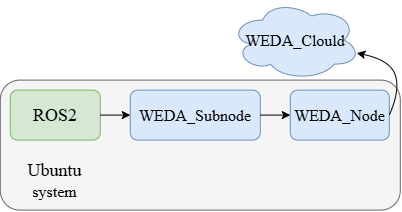

# Ros2 Wedasubnode Bridge
   
  This document will explain how to transfer ros2 topic data to WedaSubNode. 

  

  **IMG1:ROS2_With_WEDA_Architecture**


## Device and install version
- Device: QCS9075
- Ubuntu Version: Ubuntu 24.04 LTS
- WEDA Node Activator Version: V1.1.0_20260527.1 Ubuntu-arm64-offline
- Postmen Version: 11.71.7
- ROS2 jazzy

## Install Steps

The [official website](https://learn.advantech.com/zh-tw/weda/docs/Function_Explanation/SubNode) explains that "WEDA-Sub-Node" have multiple protocols.This case uses the MQTT protocol.

Before you begin using this file, please ensure that the WEDA-Sub-Node is installed.

Download [ WEDA-Sub-Node.](https://github.com/Advantech-WEDA/WEDA-Sub-Node)

- Step1:

  Download this [ROS2 container](./source/ros2_wedasubnode_bridge_container.zip) and unzip it.

  Assign a name to each MQTT topic.
  Use only English letters, numbers, and underscores; do not include spaces or".".

  For example:
  | Bridge name | ROS topic | MQTT topic |
  | --- | --- | --- |
  | robot_position | /odom | Robot_position |
  | robot_battery | /battery_state | Robot_battery |
  | robot_velocity | /cmd_vel | Robot_velocity |

 
- Step2:

  Check the types and fields for each topic.

  For example:
  ```
  ros2 topic info /battery_state          # check Type
  ros2 interface show sensor_msgs/msg/BatteryState   # check fields
  ```

- Step3:

  Edit bridge.yaml to setting mqtt port, MQTT topic,ros2 topic etc.

  If you want to publish two or more ros topic ,you need to add all bridge_names at this part:
  ```
  bridge_names: [robot_position, robot_battery, robot_velocity]
  ```
  and add each bridge_names content:
  ```
  bridges:
    robot_position:
      enabled: true
      ros_topic: /odom
      ros_type: nav_msgs/msg/Odometry
      mqtt_topic: Robot_position
      mqtt_qos: 0
      mqtt_retain: true
      fields:
        - "x=pose.pose.position.x"
        - "y=pose.pose.position.y"
        - "z=pose.pose.position.z"
        - "angle_deg=yaw_deg_360(pose.pose.orientation)"
      include_envelope: false
      round_decimals: 2
      min_interval_sec: 0.5
      buffer_latest: true
      ros_qos_reliability: best_effort

    robot_battery:
      enabled: true
      ros_topic: /battery_state
      ros_type: sensor_msgs/msg/BatteryState
      mqtt_topic: Robot_battery
      mqtt_qos: 0
      mqtt_retain: true
      fields:
        - "voltage=voltage:float"
        - "percentage=percentage:float"
      include_envelope: false
      round_decimals: 2
      min_interval_sec: 1.0
      ros_qos_reliability: best_effort

  ```

- step4:

  Run (Using Docker container):
    ```
    $ cd ros2_wedasubnode_bridge
    $ docker compose build
    $ docker compose up -d
    $ docker compose logs -f
    ```

- step5:

  Test
    Check MQTT had received the data.
    ```
    mosquitto_sub -h 127.0.0.1 -t 'Robot_position' -v    
    ``` 
    if you don't have the robot you can simulate publish a /odom topic in docker.
    ``` 
    docker exec -it ros2_wedasubnode_bridge bash -c \
    "source /opt/ros/jazzy/setup.bash && \
    ros2 topic pub -r 2 /odom nav_msgs/msg/Odometry \
    '{pose: {pose: {position: {x: 1.5, y: 2.0, z: 0.0}, orientation: {x: 0.0, y: 0.0, z: -0.4657731422728534, w: 0.8849041642671099}}}}'"
    ``` 
- step6:

  Download this [WEDA_subnode project](./source/WEDA_Subnode/) . 
  Copy all file in WEDA_Subnode to path "WEDA-Sub-Node/app/testmqttsubnode"

  Therefore, your folder structure will be:

  ```
    WEDA-Sub-Node/
    └── app/
        └── testmqttsubnode/
            ├── testmqttsubnode.tar.gz(No need to decompress)
            ├── .evn
            ├── docker-compose.yml
            └── docker-entrypoint.sh
  ```

- step7:
  
  Loading testmqttsubnode.tar.gz
  ```
  docker load -i testmqttsubnode.tar.gz
  docker images testmqttsubnode
  ```
  If you see "testmqttsubnode latest", it means the operation was successful. You can delete the ".tar.gz" file after loading it.

- step8:

  Modify files:

  - .env

    Modify
    ```
    WEDA_NODE_USERNAME=Your account
    WEDA_NODE_PASSWORD=Your password


    WEDA_CLOUD_URL=Your URL

    MQTT_CLIENT_ID=Your client ID
    MQTT_TOPIC=Your topic name
    SUBNODE_NAME=Your subnode name
    ```
    Set permissions for the .env file
    ```
    chmod 600 .env
    ```
    Hint:

    SUBNODE_NAME used for cloud registration; must be unique within the same cloud environment—each device requires a distinct identifier. It is recommended to use only alphanumeric characters.
    
    

  - docker-compose.yml

    Modify
    ```
    WEDA__CLOUD__URL=${your URL}
    ```

  - docker-entrypoint.sh

    Set permissions for the docker-entrypoint.sh file
    ```
    chmod +x docker-entrypoint.sh
    ```

- step9:

  Run docker
  ```
  docker run -d --name testmqttsubnode \
  --network host \
  --restart unless-stopped \
  --env-file .env \
  -e WEDA__CLOUD__URL=Your URL \
  -v "$(pwd)/weda-data:/app/.weda" \
  -v "$(pwd)/docker-entrypoint.sh:/usr/local/bin/docker-entrypoint.sh:ro" \
  testmqttsubnode:latest

  docker logs -f testmqttsubnode
  ```
    


  


